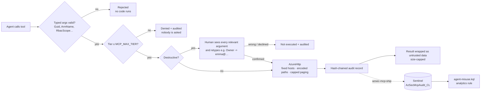

# azsec-mcp

**A security-governed MCP server that lets an AI agent work a Microsoft security tenant
(Entra ID, Intune, Defender for Cloud, Sentinel, Purview) without becoming the attacker's
easiest path in.**

An agent that can read incident comments and also wipe devices is one injected sentence away
from wiping the wrong device. This server treats the AI agent as a powerful but gullible
operator and puts every tool behind the same deterministic controls: typed arguments, a tier
ceiling, human confirmation for destructive actions, untrusted-output marking, a hash-chained
audit trail shipped to Sentinel, and a detection rule that watches the agent itself.

64 tools · 11 documented capability gaps · 244 tests · Python 3.12 · MCP SDK 2.3.0

---

## How one tool call is handled



| Layer | Module | What it stops |
|---|---|---|
| Typed IDs + `seg()` | `ids.py` | path/OData injection (`X/wipe?` turning a reboot into a wipe) |
| Tier ceiling | `policy.py` | doing more than the session needs; read-only by default |
| Human confirmation | `confirm.py`, `server.py` | an agent misled into wiping, deleting, granting or closing |
| Host allowlist | `http.py` | bearer token leaking through `nextLink` or redirects |
| Untrusted envelope | `untrusted.py` | injected text treated as instructions; context flooding |
| Hash-chained audit | `audit.py` | unattributable actions; edited/deleted log lines |
| Off-box anchor | `ship.py`, `infra/`, `detections/` | tail truncation, log rewrites, silent misuse |

Privileged Azure roles (Owner, Contributor, User Access Administrator, RBAC Administrator, or any
role that can write role assignments) and all AU-scoped Entra roles are never assigned active:
they become **time-bound PIM eligibility** with a justification, which the user activates in PIM.

Full mapping of threats to controls and the tests that prove them: **[docs/THREAT_MODEL.md](docs/THREAT_MODEL.md)**.
Identity grants and the least-privilege target: **[docs/PERMISSIONS.md](docs/PERMISSIONS.md)**.

## Tools

| Domain | Tools | Destructive (human retypes) |
|---|---|---|
| Identity & access | 14 | delete RG, assign role, delete user, assign AU role, add AU member |
| Intune | 16 | retire, wipe |
| Defender for Cloud | 4 | update alert |
| Sentinel | 17 | update incident |
| Purview & eDiscovery | 11 | |
| Entra logs | 2 | |

`azsec://capability-gaps` lists what's deliberately not a tool (for example DLP policies and
retention labels, which have no app-only Graph API) and where to do it instead.

## Run it

```bash
git clone https://github.com/Arasefe/azure-mcp-server && cd azure-mcp-server
uv sync --locked
cp .env.example .env    # tenant, client, subscription, Sentinel RG + workspace
# put the service principal certificate at cavalry-sp.combined.pem (gitignored)
uv run pytest -q        # 244 tests, no Azure calls (respx mocks)
```

Register with Claude Code (stdio; Claude Code starts the server itself):

```bash
claude mcp add azure-mcp-local -s user -- uv run --directory "$PWD" azsec-mcp
```

The session ceiling comes from `.env`: `MCP_MAX_TIER=read` (default), `write`, or `destructive`.
Destructive tools also need a client that supports MCP elicitation (Claude Code CLI); otherwise
they fail closed.

Recommended: stop the agent from editing its own config. In `~/.claude/settings.json`:

```json
{ "permissions": { "deny": ["Edit(//<repo-path>/.env)", "Write(//<repo-path>/.env)"] } }
```

## Prove it

```bash
uv run pytest tests/security -v    # confirmation + end-to-end prompt-injection scenario
uv run pytest -q && uv run ruff check && uv run pyright
```

CI (`.github/workflows/ci.yml`) runs the tests, ruff, pyright, Trivy on `uv.lock`, gitleaks on
the full history, and Semgrep. Every action is pinned to a commit SHA and every image to a version.

## Off-box audit (optional)

`infra/README.md` deploys a Sentinel table and DCR (Bicep), schedules `azsec-mcp-ship`, and
turns `detections/agent-misuse.kql` into an analytics rule for refused destructive calls,
refusal bursts, chain-integrity failures and missing heartbeats.

## How it was built

This started as a 794-line JavaScript server. The rewrite went through a Research → Plan →
Implement → Validate loop with test-first development, live Microsoft Learn verification of
every API, mutation checks on the security tests, and automated security review on every
commit. The artifacts are in `docs/rpiv/azure-mcp-showcase/`. Bugs found in the original along
the way included a reboot→wipe path injection, inverted permission flags, an alert update that
called a non-existent API, an eDiscovery holds call to the wrong endpoint, and three tools that
only pretended to work.
